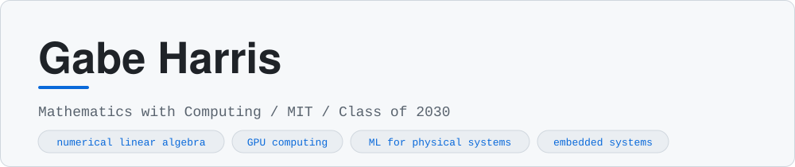
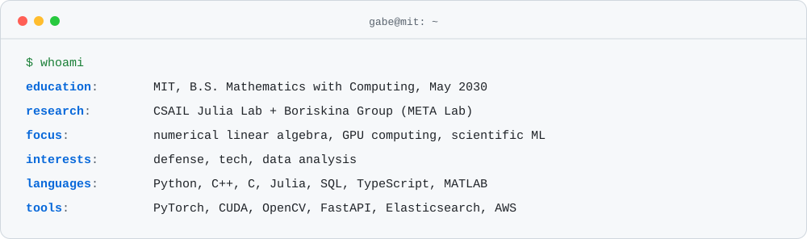
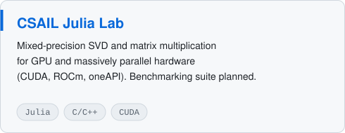
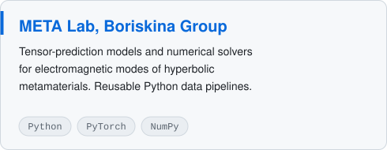
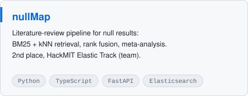

<picture><source media="(prefers-color-scheme: dark)" srcset="assets/header-dark.svg"></picture>

<a href="https://www.linkedin.com/in/gabe-harris-424378301/">LinkedIn</a> &nbsp;/&nbsp; <a href="mailto:gkharris@mit.edu">Email</a> &nbsp;/&nbsp; <a href="https://github.com/SREagle999?tab=repositories">Repositories</a>

<picture><source media="(prefers-color-scheme: dark)" srcset="assets/about-dark.svg"></picture>

### Currently

- Researching **mixed-precision SVD and matrix multiplication** for GPU and massively parallel hardware (CUDA, ROCm, oneAPI) in the **CSAIL Julia Lab**
- Building **tensor-prediction models and numerical solvers** for anisotropic metamaterials in the **Boriskina Group** (META Lab)
- Writing safety-critical embedded C/C++ for a CubeSat on the **MIT Satellite Team** using NASA's F Prime
- Building ETL and ML pipelines as a **Data Analyst & Engineer at Capital One**
- Studying graduate Deep Learning, Low-Level Programming, Theory of Computation, and Topology

### Featured

<picture><source media="(prefers-color-scheme: dark)" srcset="assets/card-julialab-dark.svg"></picture>
<picture><source media="(prefers-color-scheme: dark)" srcset="assets/card-metalab-dark.svg"></picture>
<a href="https://github.com/conrad204/NullMap"><picture><source media="(prefers-color-scheme: dark)" srcset="assets/card-nullmap-dark.svg"></picture></a>

### Experience

| Where | Role | What I did |
| :-- | :-- | :-- |
| **Capital One** | Data Analyst & Engineer | ETL and ML pipelines over AWS and Snowflake. Feature engineering and sensitivity testing for credit policy and pilot programs. |
| **CSAIL Julia Lab** | Undergraduate researcher | Faster mixed-precision linear algebra for GPU and parallel hardware. Algorithm design, benchmarking, refinement. |
| **Boriskina Group** | Undergraduate researcher | Tensor-prediction models and numerical solvers for electromagnetic modes of hyperbolic metamaterials. Reusable Python data pipelines. |
| **MIT Satellite Team** | Programmer, electrical engineer | Embedded C/C++ for CubeSat intercomponent communication on NASA F Prime. |
| **FIRST Robotics** | Team captain, CAD captain | Led 45+ students through design, manufacturing, sensors, and strategy. Qualified for Worlds. Engineering Inspiration Award (2024). |

### Recognition

- 2nd place (team), HackMIT 2026 Elastic Track, for nullMap
- Air Force ROTC Type 1 scholarship
- National Merit Scholar
- MathWorks M3 Challenge, advanced past Triage
- FIRST Robotics World Championship qualifier, Engineering Inspiration Award (2024)
- MIT RAMP

### Stack

<picture><source media="(prefers-color-scheme: dark)" srcset="https://skillicons.dev/icons?i=py,cpp,c,julia,java,ts,js,react,fastapi,matlab&theme=dark&perline=10"></picture>
 
<picture><source media="(prefers-color-scheme: dark)" srcset="https://skillicons.dev/icons?i=pytorch,opencv,aws,git,linux,vercel,raspberrypi,arduino,latex,vscode&theme=dark&perline=10"></picture>

Also: NumPy, SciPy, Pandas, scikit-learn, Statsmodels, XGBoost, CUDA, ROCm, OpenMP, Snowflake, Elasticsearch, KiCad, Fusion 360, ESP32.

### Activity

<picture><source media="(prefers-color-scheme: dark)" srcset="https://streak-stats.demolab.com/?user=SREagle999&hide_border=true&card_width=600&background=0D1117&stroke=30363D&ring=58A6FF&fire=3FB950&currStreakNum=E6EDF3&sideNums=E6EDF3&currStreakLabel=58A6FF&sideLabels=8B949E&dates=8B949E"></picture>

Cards in this README are generated by <a href="scripts/build.py">scripts/build.py</a>.

Open to research and engineering opportunities in scientific computing, ML, and systems. <a href="https://www.linkedin.com/in/gabe-harris-424378301/">Say hi on LinkedIn.</a>

